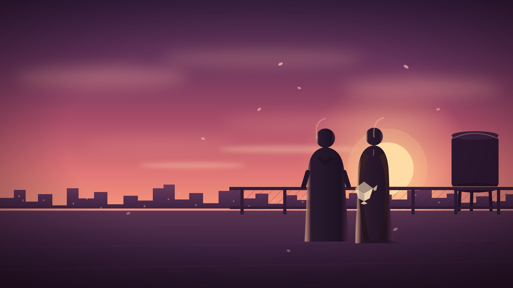

# Paper Sunsets

> A story about the things we write instead of saying.

**Paper Sunsets** is a short, browser-based romantic visual novel set over five afternoons at a school that smells like rain and chalk. Kai finds an anonymous note in his desk and a folded paper crane on the rooftop railing. Someone is leaving him notes. Someone is waiting for him to figure out who.



- About 20 minutes per playthrough
- Six choices that shape the story, plus a final decision and four endings
- A hidden clue system that changes the final choice's wording and ending dialogue
- Autosave, three manual save slots, a backlog, auto/skip, text speed, and reduced motion
- An endings gallery that remembers what you have discovered
- Vanilla HTML, CSS, and JavaScript — no build step, no dependencies

## Play locally

Because the game is entirely static, you can open `index.html` directly. For a more browser-like environment (and to test the GitHub Pages paths), serve the folder:

```bash
python -m http.server 8000
```

Then visit <http://localhost:8000>.

You can also use any static file server, such as `npx serve .`.

## Controls

| Action | Input |
| --- | --- |
| Advance / finish a line | Click, `Space`, `Enter`, or `→` |
| Open the backlog | `L` or the Log button |
| Toggle auto-play | `A` or the Auto button |
| Open the menu | `Esc` or the Menu button |

Settings include text speed, auto-play delay, and a reduced-motion mode.

## Endings

There are four endings. The final choice is always available in every route, but the wording of one option and some of the ending dialogue depend on how many clues you have noticed.

<details>
<summary>Ending titles (light spoilers)</summary>

1. **Meet Me at Sunset**
2. **Keep Writing**
3. **The Wrong Name**
4. **The Empty Roof**

</details>

## Project structure

```text
PaperSunsets/
├── index.html
├── css/
│   └── style.css
├── js/
│   ├── story.js      # All dialogue, choices, flags, and endings
│   └── engine.js     # Story runtime, saves, UI, audio-free presentation
├── assets/
│   ├── bg/           # Five hand-authored SVG backgrounds
│   ├── char/         # Mira's four expressions
│   ├── title/        # Key art
│   └── favicon.svg
└── .github/workflows/pages.yml
```

All dialogue and branching live in `js/story.js`. The asset registry is at the top of `js/engine.js`, so art can be replaced without touching the story.

## Art

Every visual in this repository is original hand-authored SVG art: the key art, five backgrounds, Mira's four expressions, and the crane motif. The engine supports swapping in PNG, JPG, or WebP files by changing the paths in the `ASSETS` registry.

## Deploying to GitHub Pages

The included workflow publishes the repository root to GitHub Pages whenever `main` is pushed. There is no build step.

1. Push the repository to GitHub.
2. In **Settings → Pages**, set **Source** to **GitHub Actions**.
3. Run the workflow (or push to `main`) and wait for the deployment to finish.

### Custom domain with Cloudflare

A `CNAME` file is intentionally not committed so the same build can be deployed to any host. When you are ready to attach the domain:

1. Add the site to Cloudflare and create a `CNAME` record for your chosen subdomain (for example, `paper`) pointing to `<your-username>.github.io`.
2. Use **DNS only** for the first verification, then optionally enable the Cloudflare proxy.
3. In GitHub, open **Settings → Pages → Custom domain**, enter the domain, and save.
4. Enable **Enforce HTTPS** once the certificate is issued.

For an apex/root domain, use Cloudflare's CNAME flattening (or GitHub's documented A/AAAA records) instead of a plain CNAME.

## License

All rights reserved. See [LICENSE](LICENSE).
